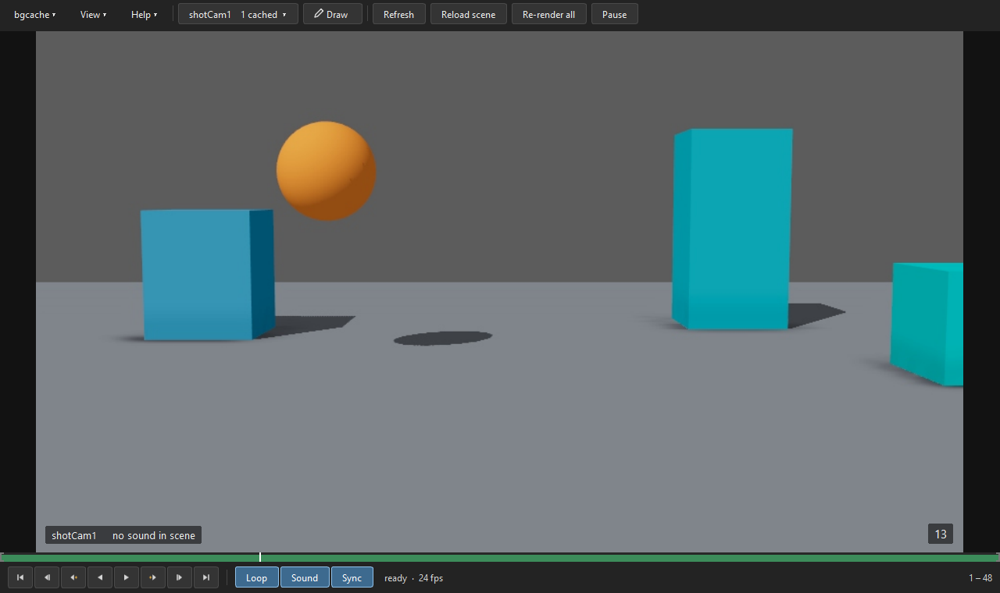

# MK Anim Tools

Maya tools made by an animator for animators: less waiting, more animating.
Free and open source (MIT).

| Tool | What it does | Status |
|---|---|---|
| **[BGCache](bgcache/)** | Live playback for heavy shots. A hidden second Maya re-playblasts only the frames your edits change, and a player plays them at full speed with sound, while you keep animating. Draw over it, too. | **Beta: download it** |
| **Shot Transfer** | Copy animation and constraints (prop attach setups too) from another shot's file into yours, one frame or the whole range, without opening that file. | Coming soon |
| **Reference Editor** | Bring your video reference into your shot. It finds the takes in your reference file automatically. Pick and trim the ones you want, then place them in Maya: on the shot camera, in front of or behind your character, or as free planes in the scene. | Coming soon |

## Download

Get the latest BGCache from [Releases](https://github.com/Marek-672/Maya-Tools/releases):
pick the zip for your system, unzip it, drag `install_bgcache.py` into a Maya
viewport and choose **Install**. Maya 2024 or later, on Windows, macOS or
Linux. More in [bgcache/README.md](bgcache/README.md).

## Help and feedback

Found a problem or have an idea? Open an
[issue](https://github.com/Marek-672/Maya-Tools/issues/new/choose).

## Support

The tools are free. If they save you time and you'd like to say thanks, a
donation helps me keep making them. <!-- SUPPORT_LINK -->

## Licence

MIT, see [LICENSE](LICENSE). Copyright (c) 2026 Marek Kochout.
